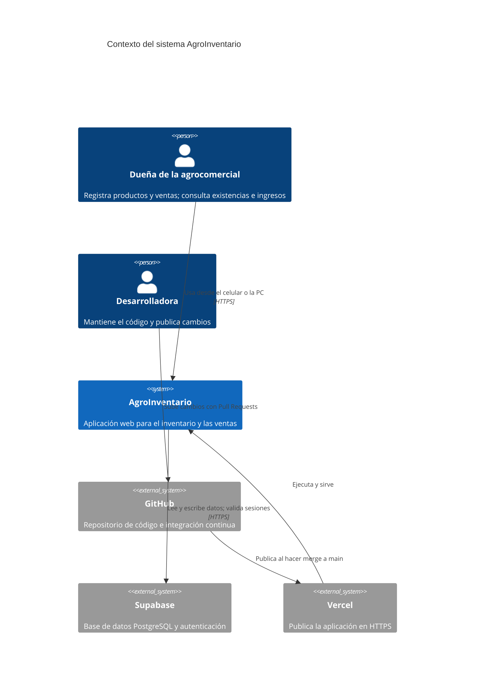
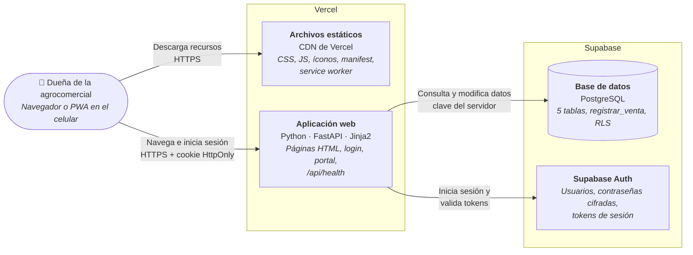
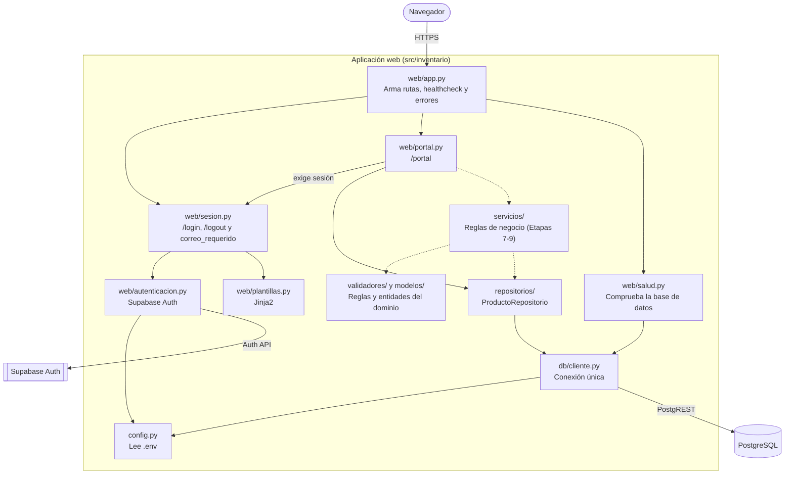
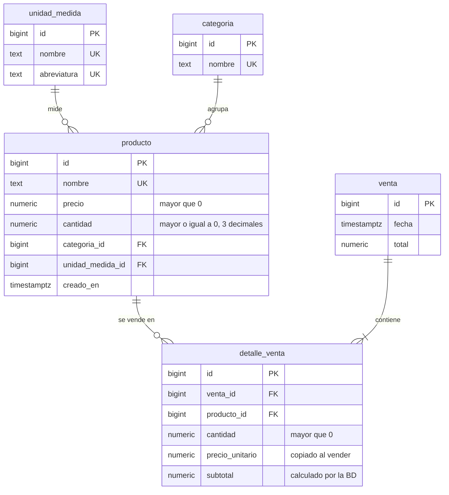

# Arquitectura - Sistema de Inventario Agrocomercial

Documento vivo: se actualiza en cada etapa. Las decisiones importantes se registran como ADRs
(*Architecture Decision Records*) en [`docs/adr/`](adr/).

| ADR | Decisión |
|---|---|
| [ADR-001](adr/ADR-001-persistencia.md) | Usar PostgreSQL gestionado en Supabase con la venta como transacción atómica en la base de datos |
| [ADR-002](adr/ADR-002-autenticacion.md) | Usar Supabase Auth con sesión en cookie HttpOnly validada en el servidor |

## 1. Requisitos funcionales

| ID | Requisito |
|---|---|
| RF-01 | Registrar producto (nombre, precio, cantidad) |
| RF-02 | Listar productos con su cantidad disponible |
| RF-03 | Actualizar nombre, precio o cantidad de un producto |
| RF-04 | Listar productos agotados (cantidad = 0) |
| RF-05 | Registrar venta con uno o varios productos |
| RF-06 | Descontar automáticamente el inventario vendido |
| RF-07 | Rechazar la venta completa si no hay existencias suficientes |
| RF-08 | Guardar fecha, productos, cantidades, precio unitario y total |
| RF-09 | Consultar ventas de un día |
| RF-10 | Total de ingresos por día |
| RF-11 | Productos vendidos y cantidades en un período |

**Reglas:** nombre obligatorio y único; precio > 0; cantidad >= 0 (decimales permitidos);
venta con al menos un producto y cantidades > 0; secretos solo en `.env`.

**Requisitos no funcionales:** sitio en HTTPS (Vercel), PWA instalable, diseño responsive,
SEO y Open Graph, headers de seguridad, página 404, healthcheck JSON, login real y portal privado
que no muestre datos sin sesión.

**Fuera de alcance (YAGNI):** roles y permisos, registro público de usuarios, proveedores, compras, facturación.

## 2. Diagramas C4

El modelo C4 describe el sistema en niveles de zoom: contexto (quién lo usa y con qué se conecta),
contenedores (qué piezas se despliegan) y componentes (cómo está organizado el código por dentro).

### Nivel 1 - Contexto

### Nivel 2 - Contenedores

Qué piezas se despliegan y cómo se comunican (diagrama de contenedores C4 dibujado como flowchart para mayor legibilidad).

### Nivel 3 - Componentes de la aplicación web

Las flechas punteadas son componentes planeados para las próximas etapas.

## 3. Modelo de datos (Supabase / PostgreSQL)

Decisiones (detalle en [ADR-001](adr/ADR-001-persistencia.md)):
- `NUMERIC` en lugar de `float` para evitar errores de redondeo.
- `CHECK` en la base de datos como última barrera (precio > 0, cantidad >= 0).
- Totales diarios se calculan con consultas, no se almacenan (DRY).
- `registrar_venta(jsonb)`: función atómica con `FOR UPDATE`; todo o nada.
  Códigos: `AG001` venta vacía, `AG002` cantidad inválida, `AG003` producto no existe,
  `AG004` stock insuficiente, `AG005` producto repetido.
- RLS activo en las 5 tablas, con políticas `RESTRICTIVE` `denegar_clientes_<tabla>` para los roles
  `anon` y `authenticated`: los clientes nunca acceden directo a las tablas; solo el backend, con la clave
  `service_role`, lee y escribe (migración 004).
- `exportar_esquema()` lee el catálogo de PostgreSQL y genera el esquema real en JSON;
  `python -m inventario.herramientas.exportar_esquema` lo guarda en [`docs/db-export.json`](db-export.json).

Scripts en `supabase/migraciones/`, ejecutados en orden. Son la única fuente de verdad del esquema
(antes existía un script combinado que duplicaba las migraciones; se eliminó por DRY).

## 4. Capas de la aplicación

| Capa | Responsabilidad | Estado |
|---|---|---|
| `web/app.py` | Arma la aplicación: rutas, healthcheck, errores | ✅ |
| `web/sesion.py` | Login, logout y dependencia `correo_requerido` | ✅ |
| `web/autenticacion.py` | Habla con Supabase Auth (iniciar sesión, validar token) | ✅ |
| `web/portal.py` | Portal privado; su repositorio depende de la sesión | ✅ |
| `web/plantillas.py` | Configuración única de Jinja2 | ✅ |
| `repositorios/` | Leer/escribir en Supabase, sin lógica de negocio | 🔄 |
| `modelos/` | Representar datos del dominio (inmutables, válidos por construcción) | ✅ |
| `validadores/` | Reglas del negocio: precio, cantidad, nombre, ids, venta sin repetidos | ✅ |
| `servicios/` | Reglas de negocio; reciben repositorios por parámetro (mockeables) | ⏳ Etapas 7-9 |
| `db/cliente.py` | Crear la conexión una sola vez | ✅ |
| `config.py` | Leer `.env` | ✅ |
| `errores.py` | Excepciones propias | ✅ |

**Despliegue:** `app.py` (raíz) expone la app de FastAPI para Vercel; `public/` lo sirve el CDN
de Vercel; `vercel.json` define los headers de seguridad. Cada merge a `main` se publica solo.

### Seguridad de la sesión (detalle en [ADR-002](adr/ADR-002-autenticacion.md))

- Supabase Auth guarda las contraseñas cifradas; no se implementa un sistema propio.
- Cookie `sesion`: `HttpOnly`, `Secure`, `SameSite=Lax`, dura lo mismo que el token (1 h).
- Cada visita a `/portal` valida el token con Supabase. Sin sesión no se consulta la base de datos.
- El portal responde con `Cache-Control: no-store` y `noindex`.

## 5. Pruebas

- `tests/unitarias/`: sin internet, con mocks. `pytest -m "not integracion"`
- `tests/integracion/`: contra Supabase real; se omiten si no hay `.env`.
- GitHub Actions ejecuta en cada Pull Request: instalación bloqueada por hash, `ruff`, `pytest` con cobertura
  y análisis de SonarCloud. La rama `main` está protegida y exige que el CI pase.
- Cobertura versionada en `coverage/lcov.info`.

## 6. Git

GitHub Flow: `main` estable + ramas `feature/*`, `fix/*`, `chore/*`, `docs/*` integradas por Pull Request.
Commits con Conventional Commits (`feat:`, `fix:`, `test:`, `refactor:`, `docs:`, `chore:`, `ci:`).

## 7. Bitácora de avances

| Etapa | Estado | Resultado |
|---|---|---|
| 1. Requisitos y arquitectura | ✅ | Este documento |
| 2. Base de datos | ✅ | 5 tablas, función de venta atómica, 58 productos, 7 verificaciones SQL |
| 3. Entorno Python + Git | ✅ | Config, conexión, CI con GitHub Actions, 12 pruebas |
| 4. Sitio web en Vercel | ✅ | FastAPI, PWA, SEO, headers, 404, healthcheck |
| 5. Login y portal privado | ✅ | Supabase Auth, cookie HttpOnly/Secure, portal protegido; 20/20 en la plataforma |
| Documentación C4 + ADRs | ✅ | Diagramas de contexto, contenedores y componentes; ADR-001 y ADR-002 |
| Modelo de datos exportado | ✅ | Políticas RLS explícitas, `exportar_esquema()`, `docs/db-export.json` |
| Calidad de código | ✅ | Dependencias bloqueadas con hash, ruff, cobertura, SonarCloud, página 500, DRY del cliente |
| 6. Modelos y validadores | ✅ | `Producto`, `ItemVenta`, `DetalleVenta`, `Venta`; reglas con `Decimal`; 100 % de cobertura |
| 7. Productos | ⏳ | |
| 8. Ventas | ⏳ | |
| 9. Reportes | ⏳ | |
